<div align="center">

# ✈️ Aircraft Turnaround Analytics

**Reconstructing, modeling and predicting 5M+ aircraft turnarounds across the US domestic network (BTS 2024)**

[](https://www.python.org/)
[](https://scikit-learn.org/)
[](https://github.com/sarim512/aircraft-turnaround-analytics/actions/workflows/tests.yml)
[](https://colab.research.google.com/github/sarim512/aircraft-turnaround-analytics/blob/main/notebooks/turnaround_analysis.ipynb)
[](LICENSE)

<!-- 📊 IMAGE: generated by notebook Section 10.1 → images/12_us_risk_map.png -->
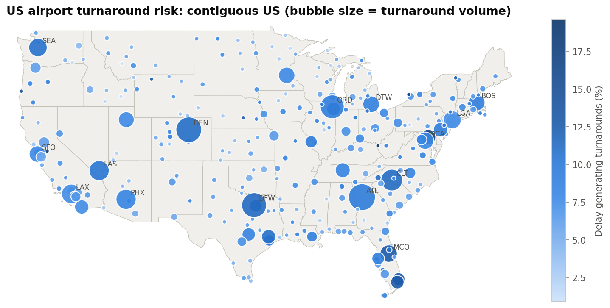

**[🗺️ Open the interactive risk map](https://sarim512.github.io/aircraft-turnaround-analytics/)** · [📓 Notebook](notebooks/turnaround_analysis.ipynb) · [📈 Result tables](outputs/)

</div>

---

## Overview

A **turnaround** is everything that happens between an aircraft landing and its next departure: deboarding, cleaning, catering, fuelling, boarding. Ground time is where airlines have the most control over delays, and where one late turn spreads through an aircraft's rotation for the rest of the day.

Public flight data doesn't record turnarounds directly. This project **reconstructs every turnaround in 2024** from the US Bureau of Transportation Statistics on-time dataset by linking consecutive flights of the same airframe (tail number). It then answers three questions:

1. **How are turnaround times distributed, and how predictable are they** across airlines and airports?
2. **Which turnarounds will generate a departure delay**, and how much does each layer of operational information add (calendar → published schedule → live inbound status)?
3. **Where and when is the network most fragile**, by hour, weekday, season and airport?

## Key Results

<!-- 📋 REPLACE this table with the contents of outputs/key_results.md (written by the last notebook section). -->

| Metric | Value |
|---|---|
| Flights analysed | 7,079,061 |
| Turnarounds reconstructed | 5,184,074 (6,097 aircraft, 15 airlines, 344 airports) |
| Median actual / planned ground time | 63 min / 56 min |
| Delay-generating turnarounds | 8.9% (naive 'actual > planned' label: 65.9%) |
| Multi-day gaps a naive clock-modulo method mistakes for turnarounds | 30,404 |
| Best-fitting distribution | Log-normal mixture (k=2) (KS = 0.019) |
| KL divergence, hubs vs regional | 0.84 bits (JS distance 0.45) |
| Median design effect (aircraft clustering) | 9.6× for mean ground time, 2.3× for delay rate |
| ROC-AUC: calendar → schedule → real-time | 0.653 → 0.690 → 0.710 |
| PR-AUC: calendar → schedule → real-time | 0.159 → 0.244 → 0.276 |
| Delays caught only with live inbound data | 6.5% of delay-generating turnarounds |
| Riskiest / safest departure window | Sun 22:00 (13.7%, n=26,328) / Mon 05:00 (4.3%, n=12,746) |
| Highest / lowest risk month | Jul (12.6%) / Oct (5.9%) |
| Highest-risk large airports | BWI, FLL, MCO, MIA, MDW |

<!-- ✍️ After running, replace every `X` below with your numbers (outputs/key_results.md, outputs/metrics.json, outputs/*.csv) and adjust any wording your results don't support. -->
**Findings**

- **Most "late turnarounds" in a naive analysis aren't delays.** Labelling a turn as delayed whenever it ran longer than planned flags `65.9%` of events, mostly aircraft that landed early and waited for their slot. Only `8.9%` actually generated a late departure.
- **Ground time is multimodal.** The best fit is `2` (ΔAIC ≈ `33923` ahead of a single log-normal), which points to separate regional quick-turn and mainline turn regimes.
- **Value of information.** ROC-AUC goes from `0.653` (calendar) to `0.690` (schedule) to `0.710` (real-time). The strongest driver is `Planned ground time`.
- **Clustering matters for uncertainty.** Treating turnarounds as independent understates variance by a median factor of `9.6` (design effect).
- **Turn-buffer reliability varies by airport.** At `SEA`, a ≤45-minute turn holds `71.9%` of the time, compared with `91.4%` at `LGA`.

---

## Methodology

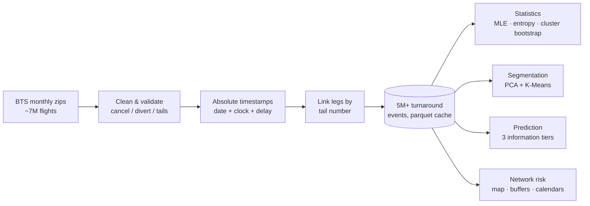

### Design decisions that make the results trustworthy

| Decision | Why it matters |
|---|---|
| **Absolute timestamps** (date + local clock + signed delay) instead of clock differences modulo 24 h | Modulo arithmetic turns an aircraft parked from Monday 10:00 to Wednesday 11:00 into a "60-minute turnaround". |
| **Events selected on *planned* ground time** (15–360 min) | Filtering on *actual* ground time selects on the outcome and silently drops the worst delays. |
| **Delay-generating label**: ground-time overrun ≥ 15 min **and** departure ≥ 15 min late | "Actual > planned" counts every early arrival that waits for its slot. This label isolates delay created on the ground, using the FAA/DOT 15-minute threshold. |
| **Date-grouped train/test split** (whole days held out) | A random row split leaks storm days and aircraft rotations between train and test. |
| **Schedule features from the full published schedule**, including later-cancelled flights | Counting only flights that operated leaks day-of disruption into "pre-departure" features. |
| **Aircraft-level cluster bootstrap & jackknife** | Turnarounds of the same aircraft are correlated, so i.i.d. resampling understates uncertainty. |
| **Common 5-min bins for entropy / KL** | Per-group bins change the entropy estimate by themselves and make groups incomparable. |
| **Permutation importance on held-out data** | Impurity importance is computed on training data and biased toward continuous features. |
| **Thresholds set on training predictions** | Avoids tuning decision thresholds on the test set. |

### Information tiers for prediction

| Tier | Available | Features |
|---|---|---|
| **Calendar** | weeks ahead | airline, airport, month, weekday, departure hour |
| **Schedule** | day of operation | + planned ground time, distance, leg of the aircraft's day, airport daily departures |
| **Real-time** | inbound aircraft has landed | + inbound arrival delay |

Model: `HistGradientBoostingClassifier` (native categorical support, early stopping), evaluated with ROC-AUC, PR-AUC, Brier score and reliability diagrams.

---

## Results

### Exploratory analysis
<!-- 📊 IMAGE: Section 3 → images/01_eda_overview.png -->
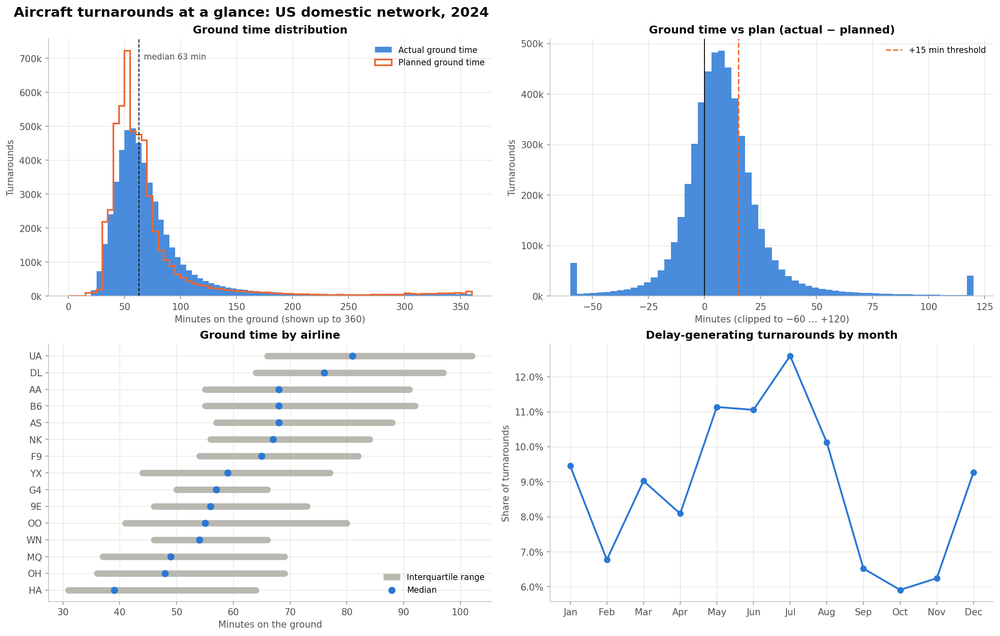

### Statistical distribution modeling
Maximum-likelihood fits ranked by ΔAIC. With millions of observations every KS *p*-value is ≈ 0, so the KS statistic is reported as an effect size.
<!-- 📊 IMAGE: Section 4 → images/02_distribution_fit.png -->
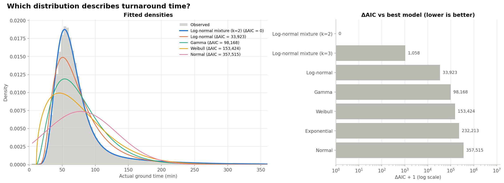

### Information-theoretic variability
Shannon entropy (unpredictability) by airline, and KL / Jensen–Shannon divergence between hub and regional airports.
<!-- 📊 IMAGE: Section 5 → images/03_entropy_kl.png -->
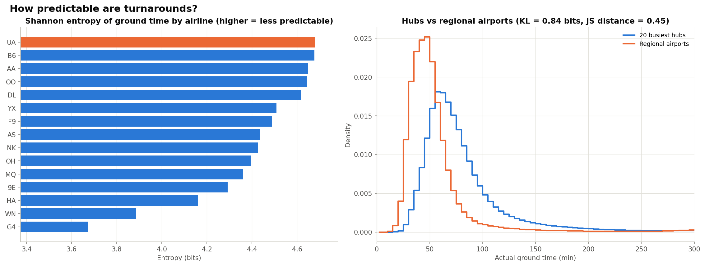

### Uncertainty quantification
Aircraft-level bootstrap confidence intervals, and the design effect: how much naive i.i.d. resampling understates variance.
<!-- 📊 IMAGE: Section 6 → images/04_uncertainty.png -->
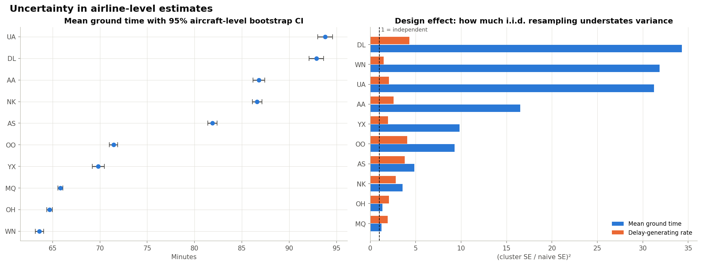

### Airport segmentation
<!-- 📊 IMAGE: Section 7 → images/05_airport_clusters.png -->
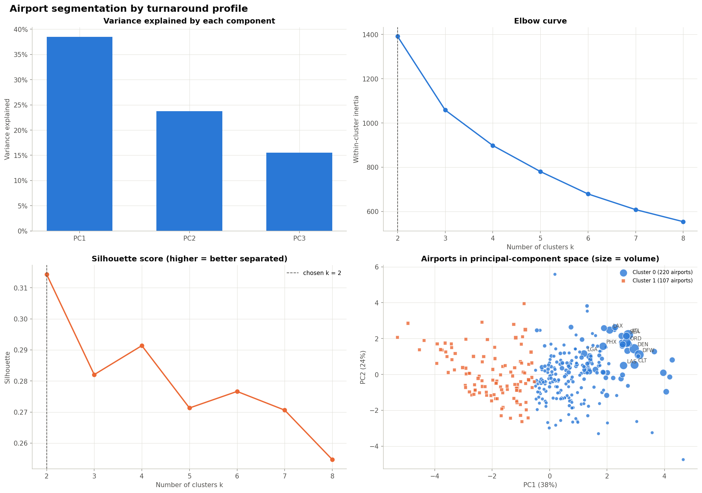

### Predictive modeling: value of information
<!-- 📊 IMAGE: Section 8 → images/06_model_performance.png -->
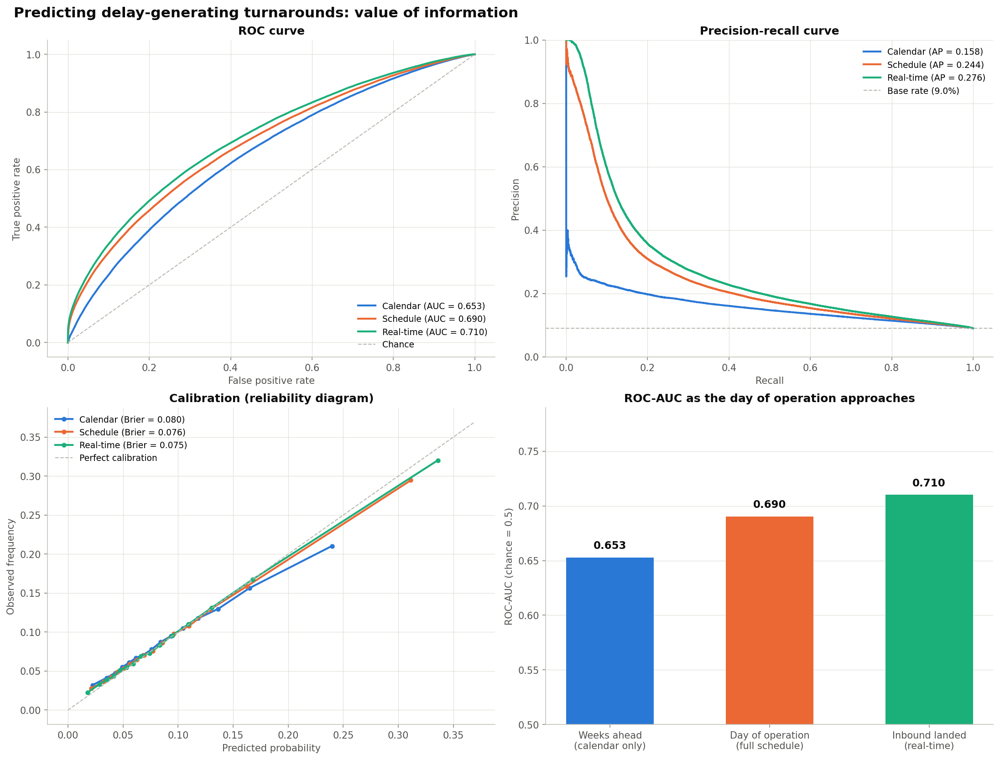

<!-- 📊 IMAGE: Section 8.1 → images/07_feature_importance.png -->
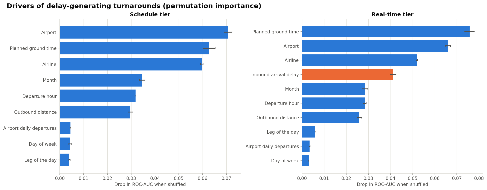

<table>
<tr>
<td width="50%"><!-- 📊 IMAGE: Section 8.2 → images/08_airline_risk_profiles.png -->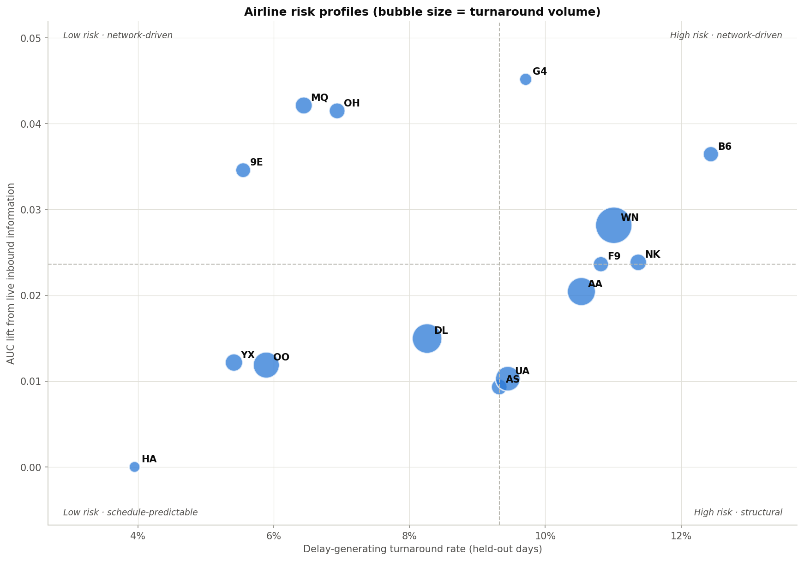</td>
<td width="50%"><!-- 📊 IMAGE: Section 8.3 → images/09_surprise_delays.png -->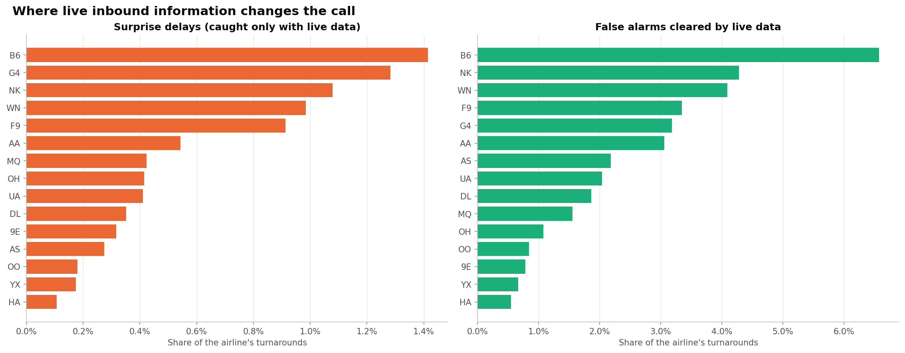</td>
</tr>
</table>

### Operational scenario analysis
<!-- 📊 IMAGE: Section 9.1 → images/10_hour_weekday_heatmap.png -->
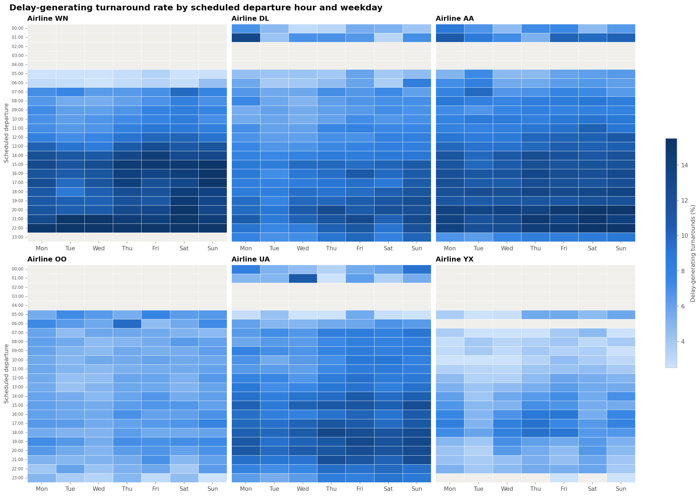

<!-- 📊 IMAGE: Section 9.2 → images/11_seasonal_calendar_airlines.png -->
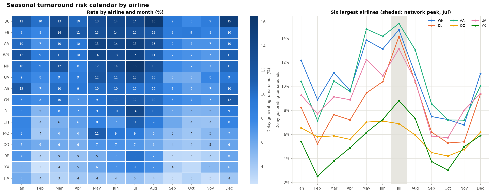

### Network risk
*If an airline schedules an X-minute turn at this airport, how often does it hold?*
<table>
<tr>
<td width="45%"><!-- 📊 IMAGE: Section 10.2 → images/13_turn_buffer_reliability.png -->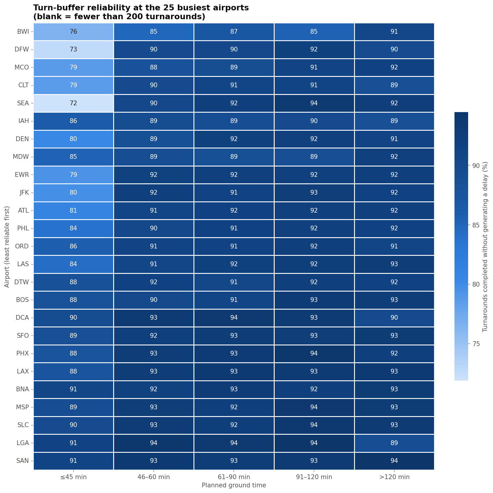</td>
<td width="55%"><!-- 📊 IMAGE: Section 10.3 → images/14_airport_seasonal_calendar.png -->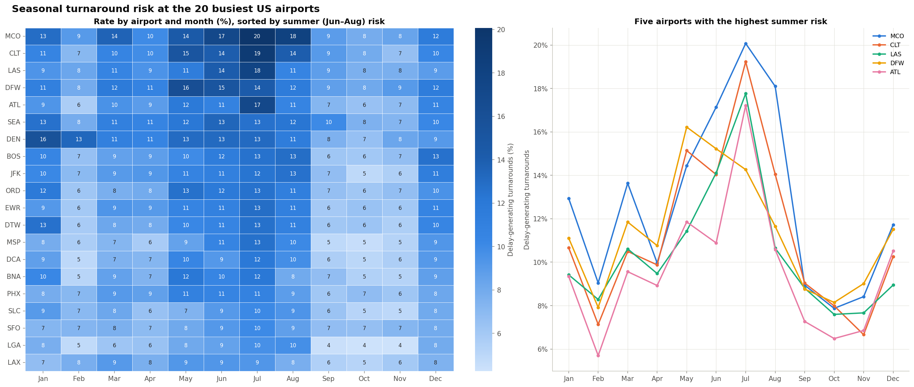</td>
</tr>
</table>

> The interactive map (hover for airport details) is published from [`docs/index.html`](docs/index.html) via GitHub Pages. GitHub's notebook viewer cannot run Plotly's JavaScript, so the README shows a static copy.

---

## Repository Structure

```
aircraft-turnaround-analytics/
├── notebooks/
│   └── turnaround_analysis.ipynb   # end-to-end analysis (outputs stripped)
├── src/
│   ├── config.py                   # paths (relative to repo root) & constants
│   ├── data.py                     # download, cleaning, turnaround reconstruction
│   ├── analysis.py                 # distribution fitting, entropy/KL, bootstrap, PCA + K-Means
│   ├── modeling.py                 # feature tiers, date-grouped split, training, evaluation
│   ├── geo.py                      # airport coordinates, risk map, static export
│   └── viz.py                      # plotting style & figure export
├── tests/
│   └── test_data.py                # unit tests for timestamp & label edge cases
├── images/                         # figures used in this README
├── outputs/                        # result tables (CSV), metrics.json, key_results.md
├── docs/                           # interactive map (GitHub Pages)
├── data/                           # downloaded & cached data (git-ignored)
├── requirements.txt
└── .github/workflows/tests.yml     # CI: runs the unit tests on every push
```

## Getting Started

### Option A: Google Colab (recommended, no setup)
1. Click **Open in Colab** above.
2. `Runtime → Run all`. The first cell clones the repo and installs dependencies. The first full run downloads ~350 MB from BTS and takes roughly 15–25 minutes on a free CPU runtime (no GPU needed).
3. The last cell downloads `turnaround_results.zip` with all figures and tables.

### Option B: Local
```bash
git clone https://github.com/x....xx/Aircraft-Turnaround-Analytics.git
cd aircraft-turnaround-analytics
python -m venv .venv && source .venv/bin/activate      # Windows: .venv\Scripts\activate
pip install -r requirements-dev.txt
jupyter lab notebooks/turnaround_analysis.ipynb
```
Needs about 8 GB of RAM. Downloaded data is cached in `data/`, so re-runs skip straight to analysis.

### Run the tests
```bash
pytest -q
```

## Data Sources

| Source | Use | License |
|---|---|---|
| [BTS Reporting Carrier On-Time Performance](https://www.transtats.bts.gov/Fields.asp?gnoyr_VQ=FGJ) (Jan–Dec 2024) | Flight-level schedule, delay, tail number | US Government public data |
| [OurAirports](https://ourairports.com/data/) | Airport coordinates & names | Public domain |
| [US Census cartographic boundaries](https://www.census.gov/geographies/mapping-files/time-series/geo/carto-boundary-file.html) | State outlines (static-map fallback only) | Public domain |

## Limitations & Future Work

- **No direct ground-ops data.** BTS has no gate, crew or ground-handling events, so turnaround *process* steps are inferred from timestamps only.
- **Label validation.** BTS delay-cause codes (`CarrierDelay`, `LateAircraftDelay`) could be used to validate the delay-generating label.
- **Out-of-time validation.** Training on 2023 and testing on 2024 would test drift. The date-grouped split prevents leakage but stays within one year.
- **Time zones.** Arrival dates are recovered from scheduled block time, which is exact within the US except for date-line routes (e.g. Guam) and the two DST transition nights.
- **Network propagation.** A graph model of aircraft rotations (e.g. delay propagation along tail-number chains) is the natural next step.

## Author

**Mohammad Sarim** · M.Tech, Smart Mobility, IIT Hyderabad

---
<sub>Released under the MIT License. Flight data © US Bureau of Transportation Statistics (public domain).</sub>
